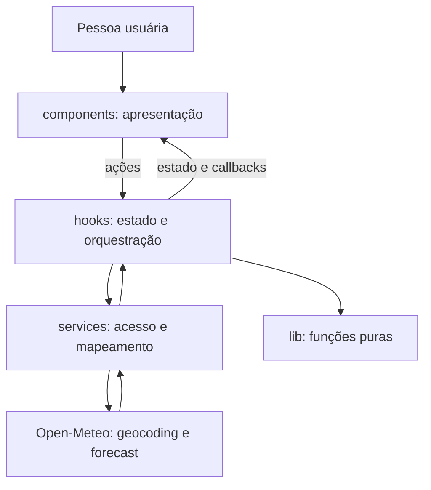
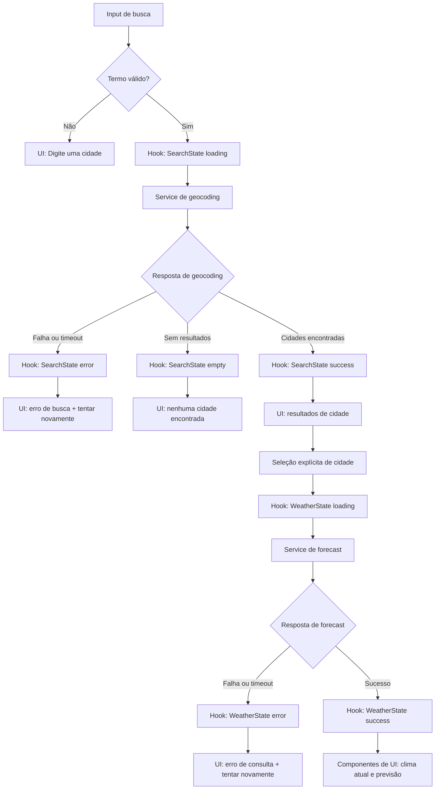

# Plano Técnico — Aplicação de Previsão do Tempo

Fonte da verdade: [`specs/weather-app-spec.md`](../specs/weather-app-spec.md). Este documento define arquitetura, decisões e contratos; não especifica a implementação final.

## Architecture

SPA React em camadas, com fluxo unidirecional e sem serviço de backend. `App.tsx` compõe a tela e conecta componentes ao hook; dependências seguem da interface para a orquestração e desta para dados/funções utilitárias, sem componentes chamarem a API diretamente.



- **Apresentação (`src/components/`)**: formulário de busca manual, resultados selecionáveis, clima atual, previsão diária, controle de unidade e estados acessíveis. Recebe estado e callbacks por props; não conhece `fetch`, timeout ou payloads Open-Meteo.
- **Orquestração/estado (`src/hooks/`)**: coordena busca, seleção, estados independentes de busca/clima, unidade, retry e descarte de respostas obsoletas. Converte resultados tipados dos serviços em estados/ações próprios da interface.
- **Acesso a dados (`src/services/`)**: executa cada chamada HTTP, impõe o timeout de 10 s com `AbortController`, classifica falhas e adapta respostas Open-Meteo aos tipos internos. Não importa React nem mantém estado visual.
- **Funções puras (`src/lib/`)**: normalização/ordenação de cidades, conversão e arredondamento de temperatura, mapeamento de códigos e formatação de data/hora. Não fazem I/O nem dependem de React.
- **Contratos (`src/types/`)**: tipos internos compartilhados; componentes e hooks não precisam conhecer os nomes dos campos de transporte.

Uma chamada de previsão retorna condições atuais e dados diários em conjunto. O serviço associa cada valor diário à data local correspondente antes de produzir o modelo interno. A seleção explícita é necessária antes de qualquer consulta meteorológica (RF1, RF2, RF3).

## Tech Stack

| Camada | Tecnologia | Decisão |
| --- | --- | --- |
| Linguagem | TypeScript strict | Contratos explícitos para dados parciais e estados assíncronos. |
| Aplicação | React + Vite | SPA estática, conforme stack do projeto. |
| Estilo | Tailwind CSS | Aplicar o tema dark glassmorphism definido nas instruções do projeto. |
| Estado | React state/hooks | Escopo pequeno; sem biblioteca externa de estado ou cache. |
| HTTP | `fetch`, `AbortController` | Sem dependência adicional; o service aborta a chamada ao atingir o timeout. |
| Testes unitários/componentes | Vitest + Testing Library | Integração com Vite e testes de comportamento acessível. |
| Testes E2E | Playwright | Fluxos ponta a ponta, viewports e navegadores da matriz candidata. |
| Dados | Open-Meteo Geocoding e Forecast | Fonte definida na spec, sem chave de API. |
| Gerenciador de pacotes | pnpm | Seguir o gerenciador adotado pelo repositório. |
| Lint e formatação | Biome | Aplicar as verificações e formatação configuradas pelo projeto. |

## Project Structure

```text
src/
├── components/
│   ├── SearchForm.tsx
│   ├── CityResults.tsx
│   ├── CurrentWeather.tsx
│   ├── ForecastList.tsx
│   ├── UnitControl.tsx
│   └── QueryStatus.tsx
├── hooks/
│   └── useWeather.ts
├── services/
│   └── weatherService.ts
├── lib/
│   ├── cities.ts
│   ├── temperature.ts
│   ├── weatherCodes.ts
│   └── dateTime.ts
├── types/
│   └── weather.ts
└── App.tsx
```

| Pasta/arquivo | Responsabilidade | Benefício para testes |
| --- | --- | --- |
| `components/` | Renderizar controles, dados e estados a partir de props; emitir ações do usuário. | Testing Library verifica conteúdo, acessibilidade e interação sem rede real nem lógica de domínio embutida. |
| `hooks/useWeather.ts` | Manter estado da experiência e coordenar chamadas, retry e concorrência. | Testar transições/loading com serviços mockados, sem depender de componentes visuais ou Open-Meteo. |
| `services/weatherService.ts` | Encapsular `fetch`, parâmetros, timeout, erros e mapeamento do payload para tipos internos. | Mock de `fetch` valida contratos, respostas parciais, falhas, timeout e respostas tardias. |
| `lib/` | Reunir transformações determinísticas sem efeitos colaterais. | Vitest testa cada função com entradas/saídas conhecidas, incluindo limites numéricos e datas/fusos. |
| `types/weather.ts` | Definir os contratos compartilhados da aplicação. | TypeScript verifica compatibilidade em build; os tipos não exigem testes de runtime próprios. |
| `App.tsx` | Compor a tela e ligar o hook aos componentes. | E2E com Playwright cobre o fluxo integrado; componentes permanecem testáveis em isolamento. |

Essa divisão mantém cada teste próximo à responsabilidade que pode falhar: regras em `lib`, integração HTTP em `services`, transições em `hooks` e comportamento observável em `components`. Playwright fica reservado aos fluxos completos e às verificações de viewport/navegador, sem duplicar toda a cobertura unitária.

## Data Model

Os valores meteorológicos ausentes, nulos ou não numéricos tornam-se `null`, nunca zero. Dados internos de temperatura ficam em Celsius; a unidade de exibição não altera a resposta armazenada.

```ts
export type Unit = 'celsius' | 'fahrenheit';

export interface City {
  name: string; // Nome retornado pelo geocoding, com grafia original.
  latitude: number; // Latitude usada na consulta de previsão.
  longitude: number; // Longitude usada na consulta de previsão.
  country: string | null; // País retornado pelo geocoding, se disponível.
  countryCode: string | null; // Código do país retornado pelo geocoding, se disponível.
  region: string | null; // Estado ou região (admin1), se disponível.
}

export interface CurrentWeather {
  temperatureC: number | null; // temperature_2m, normalizada para Celsius.
  weatherCode: number | null; // weather_code, mapeado para condição na interface.
  humidityPercent: number | null; // relative_humidity_2m, em porcentagem.
  windSpeedKmh: number | null; // wind_speed_10m, normalizada para km/h.
  pressureHpa: number | null; // surface_pressure, normalizada para hPa.
  precipitationMm: number | null; // precipitation, em milímetros.
}

export interface ForecastDay {
  localDate: string; // Data daily.time no fuso da cidade, em YYYY-MM-DD.
  minTemperatureC: number | null; // temperature_2m_min, em Celsius.
  maxTemperatureC: number | null; // temperature_2m_max, em Celsius.
  weatherCode: number | null; // weather_code diário, mapeado para condição.
  precipitationMm: number | null; // precipitation_sum diário, em milímetros.
}

export interface WeatherData {
  city: City; // Localização selecionada e associada aos dados.
  timeZone: string; // Fuso IANA retornado pelo endpoint de previsão.
  receivedAt: string; // Instante ISO em que a resposta foi recebida.
  current: CurrentWeather; // Condições atuais retornadas pela API.
  forecast: ForecastDay[]; // Exatamente cinco dias locais: hoje e os quatro seguintes.
}
```

Valores meteorológicos ausentes, nulos ou inválidos são representados por `null`, nunca por zero. `City` conserva a grafia e o contexto geográfico retornados pelo geocoding. `WeatherData.receivedAt` é distinto do horário de observação retornado pela API: a interface apresenta o instante de recebimento, formatado no fuso IANA da cidade (RF2, RNF4). `weatherCode` é mapeado para rótulo pt-BR na apresentação; códigos desconhecidos ou ausentes exibem `—`. As temperaturas são armazenadas em Celsius; `Unit` controla apenas conversão e exibição.

## Data Flow



1. A pessoa envia explicitamente o termo. A aplicação remove espaços externos; vazio/whitespace produz validação local e não chama a API.
2. O serviço consulta geocoding. A busca é normalizada sem diacríticos para tornar equivalentes as grafias acentuadas e não acentuadas; não se aplica fuzzy matching. Resultados são ordenados pelo nome em ordem alfabética pt-BR e limitados a cinco; a grafia recebida é preservada. Cada resultado inclui região/estado e país disponíveis.
3. A busca sem resultados limpa resultados anteriores e mostra estado vazio, sem iniciar consulta meteorológica. Um resultado só inicia consulta após seleção explícita.
4. Ao selecionar cidade, o hook limpa os dados apresentados como pertencentes à seleção anterior e inicia uma chamada de previsão para latitude/longitude. Ao sucesso, captura `receivedAt`, mapeia as respostas atual e diária e associa os arrays diários pelo índice/data local retornada.
5. A unidade escolhida converte e formata todos os valores de temperatura na apresentação. Alternar a unidade não refaz a chamada.
6. Busca, seleção e nova tentativa têm loading, sucesso/vazio ou erro próprios; operações obsoletas não podem substituir o estado da operação mais recente.

Para a janela diária, usar a data `YYYY-MM-DD` fornecida para o fuso da cidade, sem convertê-la por parsing UTC. Produzir exatamente cinco datas locais consecutivas, hoje e os quatro dias seguintes, preservando ordem e associação de valores, inclusive em virada de dia/horário sazonal (RF3). O service valida que `daily.time` contém cinco datas válidas e únicas; se a janela estiver estruturalmente incompleta, retorna erro recuperável em vez de sucesso com menos dias. Campos meteorológicos individuais ausentes continuam parciais com `null`.

## External APIs

### Geocoding

**URL:** `https://geocoding-api.open-meteo.com/v1/search?name=Lisboa&count=100&language=pt&format=json`

`name` recebe o termo trimado e normalizado sem diacríticos; `count=100` pede o máximo de resultados da API; `language=pt` solicita nomes/localização em português; `format=json` define o formato da resposta. Exemplo resumido:

```json
{
  "results": [
    {
      "name": "Lisboa",
      "latitude": 38.7167,
      "longitude": -9.1333,
      "country": "Portugal",
      "country_code": "PT",
      "admin1": "Lisboa"
    }
  ]
}
```

**Mapeamento para `City`:** `name` → `name`; `latitude` e `longitude` → coordenadas; `country` → `country`; `country_code` → `countryCode`; `admin1` → `region`. Contexto geográfico não retornado vira `null`, preservando a grafia da API. Como a API pode ordenar por relevância, o adaptador aplica a regra de correspondência sem distinção de acentos da spec, ordena os nomes crescentemente e só então limita a cinco. Não usar sugestões aproximadas para aceitar erro de digitação. O limite de 100 não garante cobertura de todos os homônimos globais.

### Forecast

**URL:** `https://api.open-meteo.com/v1/forecast?latitude=38.7167&longitude=-9.1333&current=temperature_2m,relative_humidity_2m,wind_speed_10m,surface_pressure,precipitation,weather_code&daily=weather_code,temperature_2m_min,temperature_2m_max,precipitation_sum&forecast_days=5&timezone=auto&temperature_unit=celsius&wind_speed_unit=kmh&precipitation_unit=mm`

`latitude`/`longitude` vêm da cidade selecionada. `current` solicita valores atuais e `daily` os agregados diários necessários. `forecast_days=5` inclui hoje e os quatro dias seguintes; `timezone=auto` devolve datas e fuso da localização. `temperature_unit=celsius`, `wind_speed_unit=kmh` e `precipitation_unit=mm` tornam explícitas as unidades de transporte esperadas pelo modelo. Exemplo resumido (campos auxiliares de unidade omitidos):

```json
{
  "timezone": "Europe/Lisbon",
  "current": {
    "time": "2026-09-30T14:30",
    "temperature_2m": 18.0,
    "relative_humidity_2m": 60,
    "wind_speed_10m": 10.0,
    "surface_pressure": 1013.0,
    "precipitation": 0.0,
    "weather_code": 0
  },
  "daily": {
    "time": ["2026-09-30", "2026-10-01", "2026-10-02", "2026-10-03", "2026-10-04"],
    "weather_code": [0, 2, 3, 61, 3],
    "temperature_2m_min": [14.0, 15.0, 15.0, 16.0, 14.0],
    "temperature_2m_max": [22.0, 23.0, 21.0, 19.0, 20.0],
    "precipitation_sum": [0.0, 0.0, 0.2, 2.1, 0.0]
  }
}
```

**Mapeamento para `WeatherData`:**

- `city` é a `City` selecionada, não um campo da resposta Forecast; `timezone` → `timeZone`.
- `current.temperature_2m` → `CurrentWeather.temperatureC`; `weather_code` → `weatherCode`; `relative_humidity_2m` → `humidityPercent`; `wind_speed_10m` → `windSpeedKmh`; `surface_pressure` → `pressureHpa`; `precipitation` → `precipitationMm`.
- `daily.time[i]` → `ForecastDay.localDate`; para o mesmo índice `i`, `temperature_2m_min`/`temperature_2m_max` → temperaturas mínima/máxima, `weather_code` → `weatherCode` e `precipitation_sum` → `precipitationMm`.
- `receivedAt` é criado pelo cliente quando a resposta é recebida; não copiar `current.time`, que representa o horário corrente/observado informado pela API.
- Validar números finitos antes do mapeamento: campo ausente, nulo ou inválido vira `null` e aparece como `—`. Manter as datas no formato local `YYYY-MM-DD`, sem interpretá-las como UTC. `precipitation_sum` é a escolha técnica para precipitação diária, ainda sujeita à confirmação semântica registrada em riscos.

Uma única chamada fornece clima atual e previsão. Falha de transporte da chamada coloca a consulta meteorológica em erro recuperável; campos inválidos individualmente permanecem parciais.

## State Management

O estado da experiência vive em `useWeather`, um hook React usado pela composição em `App.tsx`; não há biblioteca externa, cache ou persistência. Busca e consulta meteorológica são estados independentes, para que uma busca vazia/falha não seja confundida com carregamento ou falha do clima. `idle`, `loading`, `success` e `error` existem nos dois fluxos; `empty` representa somente busca concluída sem cidades. Uma resposta meteorológica com campos parciais continua em `success`, com os campos faltantes marcados como `null`.

```ts
export type SearchState =
  | { status: 'idle' }
  | { status: 'loading'; query: string }
  | { status: 'success'; results: City[] }
  | { status: 'empty' }
  | { status: 'error'; kind: 'network' | 'api' | 'timeout'; query: string };

export type WeatherState =
  | { status: 'idle' }
  | { status: 'loading'; city: City }
  | { status: 'success'; data: WeatherData }
  | { status: 'error'; kind: 'network' | 'api' | 'timeout'; city: City };
```

O hook também mantém a cidade selecionada e `Unit`, inicializada em Celsius. A unidade permanece ao trocar de cidade e só vive na sessão em memória; reload inicia Celsius (RF4). O serviço normaliza e armazena todas as temperaturas em Celsius. Na renderização, funções puras convertem cada temperatura atual/mínima/máxima conforme `Unit` (°F = °C × 9/5 + 32; °C = (°F − 32) × 5/9), arredondam empates para longe de zero em uma casa decimal e formatam com locale `pt-BR`. A mudança de unidade apenas atualiza estado de UI e valores derivados: não altera `WeatherData` nem dispara request.

Busca vazia ou composta só por espaços é validada localmente: mostra “Digite uma cidade” e não inicia geocoding. Para cada nova busca/seleção, um identificador crescente marca a operação ativa; somente sua resposta pode atualizar estado, e as respostas de operações anteriores são ignoradas mesmo que ainda estejam em andamento. O `AbortController` é propriedade do service e serve para impor o timeout; o hook é responsável por identificar operações obsoletas e não publica seus resultados (RF1, RF5, RF6).

## Error Handling

- **Rede:** rejeição de `fetch` antes do limite é `kind: 'network'`. Busca mostra “Não foi possível buscar cidades. Tente novamente.”; consulta meteorológica mostra “Não foi possível carregar os dados. Tente novamente.”. Oferecer “Tentar novamente” com o mesmo termo/cidade.
- **API/fonte:** resposta HTTP não bem-sucedida, erro declarado pela API ou payload estruturalmente inválido é `kind: 'api'`; usa as mesmas mensagens recuperáveis de falha da respectiva operação. Não classificar resposta geocoding válida sem resultados como erro.
- **Timeout:** o service controla um limite de 10 s por chamada com `AbortController` e rejeita com causa de timeout identificável. O hook traduz essa causa em estado de erro, encerra loading e permite retry; a UI mostra “A busca expirou. Tente novamente.” ou “A consulta expirou. Tente novamente.”. Respostas tardias não podem substituir o estado de erro nem preencher dados.
- **Busca vazia:** `results` ausente/vazio em resposta válida produz `SearchState.empty` e “Nenhuma cidade encontrada”; limpar resultados anteriores e não iniciar consulta meteorológica. Input vazio é validação local “Digite uma cidade”, sem chamada.
- **Resposta parcial:** validar tipo e finitude de cada campo meteorológico. Campo ausente, `null` ou inválido vira `null` e é exibido como “—”; manter os demais campos e o estado `success`, sem converter ausência em zero. Aplicar isso também a cada dia da previsão.
- **Troca de cidade/concorrência:** limpar dados anteriores enquanto a nova seleção carrega; ignorar resultados de seleção obsoleta mesmo se chegarem depois.
- Loading deve aparecer em até 1 s da ação. Mensagens e retry devem ser anunciados semanticamente (região de status/alerta), ter nomes acessíveis, funcionar por teclado e não depender apenas de cor.

## Testing Strategy

- **Vitest — funções puras (`lib/`):** conversão C/F (18 °C → 64,4 °F; 64 °F → 17,8 °C), empate negativo (31,91 °F → −0,1 °C), uma casa decimal e vírgula pt-BR; normalização de acentos/trim, ordenação alfabética e limite de cinco; mapeamento de códigos; formatação `dd/MM/aaaa` e data local em fusos/viradas sazonais.
- **Vitest — services:** mockar `fetch` e verificar URLs/parâmetros e mapeamento de payloads para tipos internos. Cobrir busca vazia e resultados de 1 a 5+, campos ausentes/nulos/não numéricos, erro de rede, resposta HTTP/API inválida, retry, timeout de 10 s com relógio falso e resposta recebida depois do timeout.
- **Testing Library — componentes/hooks:** renderizar e verificar estados `loading`, `error`, `empty` e `success` (incluindo resposta parcial); ações de busca, seleção e retry; mensagens distintas de erro/timeout; unidade inicial e alternância de todas as temperaturas sem nova chamada; nomes acessíveis, teclado e foco visível. Mockar a fronteira de serviço para não depender da rede.
- **Playwright — E2E:** fluxo buscar → selecionar cidade → conferir clima atual e cinco dias → alternar unidade; cidade homônima; nenhum resultado; erro/retry; seleção concorrente com respostas fora de ordem. Interceptar Open-Meteo via `page.route` para resultados determinísticos e evitar dependência de rede externa.
- **Playwright — responsividade e gates:** repetir os fluxos principais em 320, 768 e 1280 px; em viewport móvel, testar retrato e paisagem e confirmar ausência de rolagem horizontal e controles legíveis/operáveis. Executar smoke test na versão atual e na anterior de Chrome, Edge e Firefox em desktop, Safari em macOS e iOS, e Chrome em Android; essa matriz v1 depende de aprovação para release. Exigir acessibilidade WCAG 2.2 AA, verificação automatizada sem violações críticas e revisão manual de todos os fluxos por teclado e leitor de tela.
- **Desempenho:** registrar em cada execução o tempo da ação até o indicador de loading e até dados/erro. Loading deve aparecer em até 1 s; com APIs mockadas respondendo em até 500 ms, resultado ou erro deve aparecer em até 3 s. Essas metas automatizadas não substituem a aprovação pendente do perfil de rede e das metas de produção.

## Risks & Trade-offs

| Decisão | Alternativa considerada | Trade-off e consequência |
| --- | --- | --- |
| Estado em hooks React locais, sem biblioteca global. | Redux/Zustand ou outra store. | Menos dependências e suficiente para um único fluxo; se a aplicação ganhar telas/fluxos compartilhados, cresce o custo de coordenar estado no hook. |
| Sem cache e sem fallback offline. | React Query/SWR com cache e estratégia offline. | Evita exibir dados antigos como atuais e reduz escopo; indisponibilidade exige retry e cada nova consulta depende da rede (RNF5). |
| Um endpoint Forecast para clima atual e previsão. | Chamadas separadas para atual e diária. | Dados chegam juntos e ficam associados à mesma consulta/localização; falha da chamada afeta o conjunto todo, embora campos individuais possam ser parciais. |
| Armazenar temperaturas em Celsius e derivar exibição. | Persistir os dois valores ou pedir novamente à API ao alternar unidade. | Evita estado duplicado e request ao alternar; exige conversão/arredondamento corretos na apresentação. |
| Acesso direto do frontend à Open-Meteo, sem backend. | Proxy/backend próprio. | Mantém deploy simples e não há chave de API a proteger; limites, disponibilidade e mudanças do provedor afetam diretamente o cliente. |
| Busca manual; ordenar e limitar localmente após até 100 resultados. | Autocomplete, busca aproximada ou ordenar/limitar apenas no servidor. | Cumpre seleção explícita e evita sugerir erros de digitação; não cobre resultados além do limite recebido e pode exigir revisão da cobertura geográfica. |
| Service controla timeout/abort; hook usa identificador da operação para concorrência. | Dividir o timer entre hook e service ou confiar apenas no cancelamento. | Define uma única origem para timeout e mantém a regra “última seleção vence” na orquestração; requests obsoletas podem concluir, mas seus resultados são ignorados. |
| `precipitation_sum` para precipitação diária em mm. | `precipitation_probability_max` em porcentagem ou outra métrica. | Atende ao contrato de quantidade em mm da UI, mas a semântica ainda é pergunta aberta e deve ser confirmada antes do release. |
| Limitar geocoding a cinco após ordenar até 100 resultados recebidos. | Usar o limite padrão/menor ou confiar na ordem de relevância da API. | Permite aplicar a ordenação alfabética da spec, mas não garante os cinco primeiros de toda a cobertura global; confirmar limites e países prioritários. |
| Mapear códigos meteorológicos em utilitário local. | Exibir código bruto ou depender de um serviço adicional. | Não adiciona chamada/dependência e centraliza rótulos pt-BR; exige validação da tabela e fallback para códigos desconhecidos. |
| Timeout de 10 s definido por chamada. | Espera indefinida ou limite maior configurável pelo usuário. | Evita loading preso e oferece retry previsível; limite e perfil de rede continuam sujeitos à aprovação de release. |

Este plano cobre RF1–RF6, AC1.1–AC6.4 e RNF1–RNF7. Cobertura geográfica, semântica da precipitação/códigos, frescor, limites/termos da Open-Meteo e metas finais de release permanecem decisões de produto/fonte de dados, conforme as perguntas abertas da especificação.